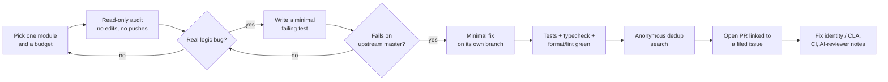

# Agent Bug-Hunt Playbook

A field-tested playbook for running AI coding agents against large open-source codebases — finding real bugs, proving them with failing tests, shipping minimal fixes, and surviving the PR gauntlet (CLA, CI, AI reviewers). The worked example: **8 open pull requests and 7 filed issues against [n8n-io/n8n](https://github.com/n8n-io/n8n)**, produced in two hunt sessions.

> **Honesty note:** every PR listed here is **open and awaiting review** as of November 2026 — none are merged. This repo documents the *process*, not guaranteed outcomes.

## Contents

- On this page: [Why this exists](#why-this-exists) · [The loop](#the-loop) · [Results](#results-n8n-case-study) · [What's in this repo](#whats-in-this-repo) · [5-minute quickstart](#5-minute-quickstart-run-a-round-on-a-new-repo) · [Principles](#principles) · [License](#license)
- Deep dives: [playbook/](playbook/) (the method) · [case-studies/n8n/](case-studies/n8n/) (one page per bug) · [prompts/](prompts/) (copy-paste agent prompts) · [templates/](templates/) (PR/issue skeletons) · [中文版](README.zh-CN.md)

## Why this exists

Most "AI finds bugs" demos stop at a hallucinated vulnerability report. The hard part is everything after the "eureka": writing a test that fails on the maintainer's `master`, keeping the fix minimal, matching the project's conventions, passing CLA and CI, and responding to automated reviewers without spamming the thread. This repo is the full loop, with real artifacts.

## The loop

## Results (n8n case study)

All links go to the real PRs and issues. Status is live-checked against GitHub, not aspirational.

| # | Bug (one line) | PR | Issue | Status |
|---|----------------|----|-------|--------|
| 1 | Source-control import fails wholesale on one malformed credential/project file | [#43952](https://github.com/n8n-io/n8n/pull/43952) | [#43951](https://github.com/n8n-io/n8n/issues/43951) | Open |
| 2 | Variable pull blanks the local value when Git tracks the same key under a different id | [#44748](https://github.com/n8n-io/n8n/pull/44748) | [#44757](https://github.com/n8n-io/n8n/issues/44757) | Open |
| 3 | Source-control pull deletes a variable that another file in the same pull moved | [#44749](https://github.com/n8n-io/n8n/pull/44749) | [#44758](https://github.com/n8n-io/n8n/issues/44758) | Open |
| 4 | Pull and policy preview still crash on malformed credential files after #43952 | [#44750](https://github.com/n8n-io/n8n/pull/44750) | — | Open |
| 5 | Export reports file entries by resource name while files are keyed by id | [#44751](https://github.com/n8n-io/n8n/pull/44751) | [#44759](https://github.com/n8n-io/n8n/issues/44759) | Open |
| 6 | Moving a variable into a scope that already has the same key creates a duplicate | [#44771](https://github.com/n8n-io/n8n/pull/44771) | [#44774](https://github.com/n8n-io/n8n/issues/44774) | Open |
| 7 | Allowed Origins (CORS) is ignored for webhooks with dynamic paths | [#44772](https://github.com/n8n-io/n8n/pull/44772) | [#44775](https://github.com/n8n-io/n8n/issues/44775) | Open |
| 8 | CORS entries after the first break when the list contains spaces (closed issue #18528 was never actually fixed) | [#44773](https://github.com/n8n-io/n8n/pull/44773) | [#44776](https://github.com/n8n-io/n8n/issues/44776) | Open |

Bugs 1–5 came from a read-only audit of the `source-control.ee` module; bugs 6–8 from a second session covering variables, webhooks, and CORS. Together: 3 data-loss/validity bugs (#44748, #44749, #44771), 2 security-adjacent CORS bugs (#44772, #44773 — the latter reviving stale-closed #18528 with a reproduction), 2 robustness fixes for malformed-file handling (#43952, #44750), and 1 API consistency fix (#44751). Every fix ships tests that fail on upstream master.

**Status verified on 2026-11-22:** all 8 PRs are open (none merged; merge blocked pending maintainer review), all 7 issues are open, and the n8n team has triaged them — the round-1 issues already carry `status:in-linear` / `status:team-assigned` labels. Every PR carries the `cla-signed` label.

## What's in this repo

| Path | What it is |
|------|------------|
| [`playbook/`](playbook/) | The method, step by step — targeting, auditing, reproduction, failing tests, minimal fixes, PR writing, identity/CLA/CI pitfalls, AI-reviewer handling, human-approval gates |
| [`case-studies/n8n/`](case-studies/n8n/) | One page per real bug: problem, root cause, reproduction, fix approach, links |
| [`prompts/`](prompts/) | Copy-paste agent prompts: hunt session, failing-test-first, dedup search, issue drafting |
| [`templates/`](templates/) | PR body and bug-issue skeletons used for the real PRs and issues linked above |
| [`README.zh-CN.md`](README.zh-CN.md) | 中文版说明 |

## 5-minute quickstart (run a round on a new repo)

1. **Aim (2 min).** Open [prompts/bug-hunt-session.md](prompts/bug-hunt-session.md), fill in the target repo, ONE module, hard scope boundaries, and a report path. Start your agent in read-only mode with it.
2. **Collect (agent time, zero of yours).** Let it audit and produce the findings ledger. Every "confirmed" claim must name a test that fails on upstream `master`; anything unproven is labeled "suspected" or dropped.
3. **Prove (5 min of yours).** For each candidate you care about, run [prompts/failing-test-first.md](prompts/failing-test-first.md) on a clean branch. Tests must fail before any fix exists — that is the whole discipline.
4. **Fix.** One bug per branch; minimal change; tests + typecheck + formatter green (see [playbook/05-minimal-fix.md](playbook/05-minimal-fix.md)).
5. **Publish (2 min).** Run [prompts/dedup-search.md](prompts/dedup-search.md), then [prompts/issue-from-fix.md](prompts/issue-from-fix.md) to draft the bug issue and PR body from [templates/](templates/). Review the drafts, approve, push, open the PR — nothing posts without your sign-off (see [playbook/08-when-to-ask-a-human.md](playbook/08-when-to-ask-a-human.md)).
6. **Follow through.** Handle identity/CLA/CI/AI-reviewer notes per [playbook/07-identity-cla-and-ci.md](playbook/07-identity-cla-and-ci.md) — the identity/CLA trap alone cost us a re-push cycle.

## Principles

- **Evidence first.** A bug that cannot fail a test on upstream `master` is a suspicion, not a finding. Label it as such or drop it.
- **One bug, one branch, one PR.** Minimal diffs get reviewed; omnibus diffs rot.
- **The agent reads, the human approves.** Pushes, issue creation, and anything outward-facing wait for explicit human sign-off.
- **Respect the project.** Match conventions, honor their templates, never copy large chunks of their code into your own repos, never spam threads or self-star.
- **Never leak secrets.** No tokens, no credentials, no personal emails in commits or docs.

## License

[MIT](LICENSE) — the playbook and prompts are yours to reuse. All referenced n8n PRs/issues belong to their respective authors under the n8n project's license.
