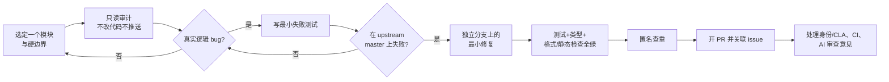

# Agent Bug-Hunt Playbook（中文版）

一份经过实战检验的作战手册：如何用 AI 编码智能体在大型开源代码库里找真实 bug——复现、用失败测试证实、提交最小修复，并扛过 PR 关卡（CLA、CI、AI 审查者）。实战案例：**两个查找周期内向 [n8n-io/n8n](https://github.com/n8n-io/n8n) 提交了 8 个 open PR 和 7 个 issue**。

> **如实说明**：截至 2026 年 11 月，下列 PR 全部为 **open、等待维护者审阅** 状态——没有一个已合并。本仓库记录的是*过程与方法*，不是保证结果的神话。

## 目录

- 本页：[为什么写这个](#为什么写这个) · [流程闭环](#流程闭环) · [实战成果](#实战成果n8n-案例) · [仓库结构](#仓库结构) · [5 分钟上手](#5-分钟上手在新仓库跑一轮) · [原则](#原则) · [许可](#许可)
- 深入内容：[playbook/](playbook/)（方法论）· [case-studies/n8n/](case-studies/n8n/)（每 bug 一页）· [prompts/](prompts/)（可复用提示词）· [templates/](templates/)（PR/issue 骨架）· [English](README.md)

## 为什么写这个

大多数“AI 找 bug”的演示止步于一份想象出来的漏洞报告。真正的难点在“灵光一现”之后：写出在维护者的 `master` 上能失败的测试、保持修复最小化、贴合项目规范、过 CLA 和 CI、回应自动审查者而不刷屏。本仓库给出完整闭环和真实产物。

## 流程闭环

## 实战成果（n8n 案例）

全部链接指向真实 PR 与 issue，状态以 GitHub 实时为准。

| # | Bug（一句话） | PR | Issue | 状态 |
|---|--------------|----|-------|------|
| 1 | 一个损坏的凭据/项目文件让 source-control 导入整体失败 | [#43952](https://github.com/n8n-io/n8n/pull/43952) | [#43951](https://github.com/n8n-io/n8n/issues/43951) | Open |
| 2 | Git 以不同 id 记录同 key 变量时，pull 会清空本地值 | [#44748](https://github.com/n8n-io/n8n/pull/44748) | [#44757](https://github.com/n8n-io/n8n/issues/44757) | Open |
| 3 | 同一次 pull 中，另一文件移走的变量被当成孤儿直接删除 | [#44749](https://github.com/n8n-io/n8n/pull/44749) | [#44758](https://github.com/n8n-io/n8n/issues/44758) | Open |
| 4 | #43952 之后 pull 与策略预览仍会因损坏凭据文件崩溃 | [#44750](https://github.com/n8n-io/n8n/pull/44750) | — | Open |
| 5 | 导出按资源名上报文件条目，而磁盘文件按 id 命名 | [#44751](https://github.com/n8n-io/n8n/pull/44751) | [#44759](https://github.com/n8n-io/n8n/issues/44759) | Open |
| 6 | 把变量移入已有同 key 的范围会产生重复 key | [#44771](https://github.com/n8n-io/n8n/pull/44771) | [#44774](https://github.com/n8n-io/n8n/issues/44774) | Open |
| 7 | 动态路径 webhook 的 Allowed Origins (CORS) 被忽略 | [#44772](https://github.com/n8n-io/n8n/pull/44772) | [#44775](https://github.com/n8n-io/n8n/issues/44775) | Open |
| 8 | 列表带空格时第一个之后的 CORS 来源全部失效（已关闭的 #18528 从未真正修好） | [#44773](https://github.com/n8n-io/n8n/pull/44773) | [#44776](https://github.com/n8n-io/n8n/issues/44776) | Open |

Bug 1–5 来自对 `source-control.ee` 模块的只读审计；6–8 来自第二轮（variables、webhooks、CORS）。合计：3 个数据丢失/数据有效性 bug（#44748、#44749、#44771）、2 个安全相关的 CORS bug（#44772、#44773——后者为被误判已修复的 #18528 带复现重新提交）、2 个健壮性修复（损坏文件不再击穿整批处理；#43952、#44750）、1 个 API 一致性修复（#44751）。每个修复都附带在上游 master 上会失败的测试。

**状态核实于 2026-11-22：** 8 个 PR 全部 open（无一合并；合并被阻止，等待维护者审阅），7 个 issue 全部 open——n8n 团队已完成分诊：第一轮 issue 已带 `status:in-linear` / `status:team-assigned` 标签。所有 PR 均带 `cla-signed` 标签。

## 仓库结构

| 路径 | 内容 |
|------|------|
| [`playbook/`](playbook/) | 方法论分步：选题、审计、复现、失败测试、最小修复、PR 撰写、身份/CLA/CI 坑、AI 审查处理、何时必须问人 |
| [`case-studies/n8n/`](case-studies/n8n/) | 每个 bug 一页：问题、根因、复现、修复思路、链接 |
| [`prompts/`](prompts/) | 可复用提示词： hunt 会话、失败测试优先、匿名查重、从修复稿写 issue |
| [`templates/`](templates/) | 用于上述真实 PR 与 issue 的 PR 正文与 bug issue 骨架 |
| [English](README.md) | 英文版 |

## 5 分钟上手（在新仓库跑一轮）

1. **瞄准（2 分钟）。** 打开 [prompts/bug-hunt-session.md](prompts/bug-hunt-session.md)，填入目标仓库、**一个**模块、硬边界和报告路径。让智能体以只读模式启动。
2. **收集（智能体时间，你零投入）。** 让它审计并产出发现台账。每个“确证”结论都必须指名一个能在 upstream `master` 上失败的测试；未证实的标注“疑似”或放弃。
3. **证实（你的 5 分钟）。** 对每个你在意的候选，在干净分支上跑 [prompts/failing-test-first.md](prompts/failing-test-first.md)。测试必须先失败、后修复——这是全部纪律所在。
4. **修复。** 一个 bug 一个分支；最小改动；测试+类型+格式检查全绿（见 [playbook/05-minimal-fix.md](playbook/05-minimal-fix.md)）。
5. **发布（2 分钟）。** 跑 [prompts/dedup-search.md](prompts/dedup-search.md)，再用 [prompts/issue-from-fix.md](prompts/issue-from-fix.md) 依据 [templates/](templates/) 起草 issue 与 PR 正文。你审阅草案、批准后推送、开 PR——未经你签字不发布任何内容（见 [playbook/08-when-to-ask-a-human.md](playbook/08-when-to-ask-a-human.md)）。
6. **跟进。** 按 [playbook/07-identity-cla-and-ci.md](playbook/07-identity-cla-and-ci.md) 处理身份/CLA/CI/AI 审查——身份/CLA 这个坑曾让我们多走一轮推送循环。

## 原则

- **证据优先。** 不能在 upstream `master` 上失败一个测试的 bug 只是怀疑；要么标为疑似，要么放弃。
- **一个 bug、一个分支、一个 PR。** 小 diff 才会被审；大杂烩只会烂掉。
- **智能体读，人类批。** 推送、开 issue、一切对外动作都要等人类明确批准。
- **尊重目标项目。** 贴合规范、遵守模板、不把项目代码大段搬进自己的仓库、不刷帖不互赞。
- **绝不泄露凭据。** 提交与文档里不放任何凭据、密钥、私人邮箱。

## 许可

[MIT](LICENSE) — 手册与提示词可自由复用。所引用的 n8n PR/issue 归各自作者与 n8n 项目许可所有。
